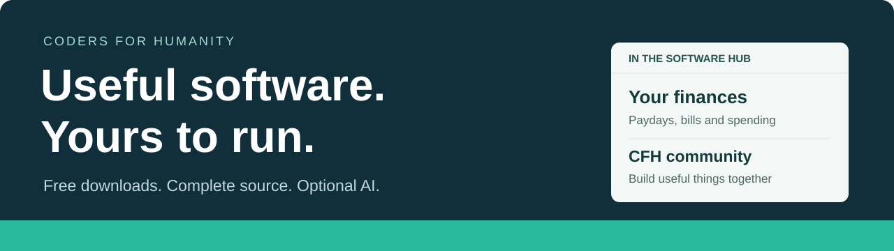

# Free software hub

Free, open-source software from Clear Frameworks and the Coders for Humanity community. Find an app, download its complete source, and use or adapt your own copy. You can work on the code yourself or with an AI assistant.

## Get software

| Software | What it does | Get it |
| --- | --- | --- |
| **[Your finances](products/finance-workspace/)** | A local planner for paydays, bills, transaction imports, and spending comparisons. No account or AI subscription required. | **[Windows installer](https://github.com/clearframeworks/coders-for-humanity/releases/download/finance-v1.0.0/Your-Finances-Setup-1.0.0-x64.exe)** · [Full source ZIP](https://github.com/clearframeworks/coders-for-humanity/raw/refs/heads/main/apps/community-platform/public/downloads/finance-workspace.zip) · [Product page](https://cfh.retehost.com/software/finance-workspace) |
| **[CFH community platform](docs/community-platform.md)** | A shared workspace for public-interest projects, contributions, and handoffs. | [Visit CFH](https://cfh.retehost.com) · [Full repository ZIP](https://github.com/clearframeworks/coders-for-humanity/archive/refs/heads/main.zip) · [Source and setup](docs/community-platform.md) |

**Windows:** download and run the installer, then open **Your finances** from your desktop or Start menu. It includes its runtime and needs no administrator install. The x64 installer is unsigned, so Windows may show a publisher warning. macOS and Linux can use the source ZIP with Node.js 24 or newer and `npm start`.

The finance app starts empty and stores your records on your computer. AI assistance is optional. The community platform has its own hosting and account setup; see its guide when running your own copy.

**[Browse the product folders](products/)** · **[Browse software on the web](https://cfh.retehost.com/software)**

*Your finances, shown with the app's fictional example plan.*

## Inside this repository

Each downloadable app has its own folder under [`products/`](products/), with source, a license, and its start or setup files. The web catalog and dedicated product pages live under [`apps/community-platform/app/software/`](apps/community-platform/app/software/). Source ZIPs live under [`public/downloads/`](apps/community-platform/public/downloads/); Windows installers are published in [Releases](https://github.com/clearframeworks/coders-for-humanity/releases).

| Folder | What belongs here |
| --- | --- |
| [`products/`](products/) | Downloadable apps, each in its own folder |
| [`apps/community-platform/`](apps/community-platform/) | The CFH website and community application |
| [`assets/`](assets/) | Hub artwork and real product screenshots |
| [`docs/`](docs/) | Development, governance, and release guides |
| [`tools/`](tools/) | Packaging and verification tools |

The CFH platform's [development guide](docs/community-platform.md) covers its own setup and verification. You do not need that setup to use a downloaded product.

## Improve or add software

Open an [issue](https://github.com/clearframeworks/coders-for-humanity/issues) for a bug, idea, or question. To contribute changes, follow [CONTRIBUTING.md](CONTRIBUTING.md). New products should follow the [product folder guide](products/README.md#adding-a-product): complete source, a dedicated landing page, a usable download, and the simplest honest setup path.

Maintainers: run the [repository checks](docs/community-platform.md#verification). After finance source changes, regenerate its download with `python tools/build-product-downloads.py`; CI verifies that the package matches the source.

## License

Application code is [MIT licensed](LICENSE). Check each product's license and any third-party asset notices. Logos and names do not transfer trademark rights. Report security issues through [SECURITY.md](SECURITY.md).
