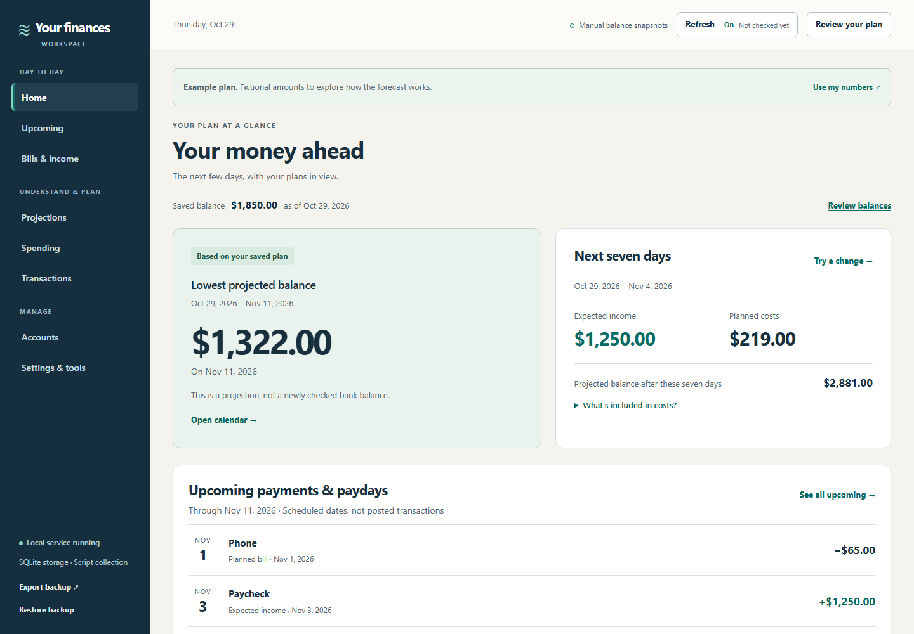

# Software catalog

[Back to the hub](../README.md) · [Web catalog](https://cfh.retehost.com/software)

Every app below includes its complete editable source. Download a product on its own, or [download the whole repository](https://github.com/clearframeworks/coders-for-humanity/archive/refs/heads/main.zip).

## Your finances

Plan paydays, bills, and daily spending, import transaction CSVs, and compare changes before saving a plan. Your records stay on your computer. AI is optional and off by default.

**[Windows installer](https://github.com/clearframeworks/coders-for-humanity/releases/download/finance-v1.1.2/Your-Finances-Setup-1.1.2-x64.exe)** · [Full source ZIP](https://github.com/clearframeworks/coders-for-humanity/raw/refs/heads/main/apps/community-platform/public/downloads/finance-workspace.zip) · [Browse source](finance-workspace/) · [Product page](https://cfh.retehost.com/software/finance-workspace)

Windows x64: run the installer, then open the desktop or Start menu shortcut. It includes its runtime and preserves financial records across upgrades and uninstall. The installer is unsigned; Windows may show a publisher warning. The portable source ZIP also runs with **Start-Finances.cmd**. On macOS or Linux, use Node.js 24 or newer and `npm start`. ARM64 portable setup remains untested on ARM hardware. [More about the app](finance-workspace/README.md).

License: [MIT](finance-workspace/LICENSE).

## CFH community platform

The community platform's source is in [`apps/community-platform/`](../apps/community-platform/). Its [guide](../docs/community-platform.md) covers local startup, hosting, account setup, and verification. [Visit the community](https://cfh.retehost.com).

## Adding a product

Give each new app a dedicated `products/<product-name>/` folder with:

- Complete source and a license, excluding private records, credentials, and runtime files.
- A short README that explains what the app does and how to start it.
- A launcher or the smallest practical setup path, with platform requirements stated beside the download.
- A dedicated page under `apps/community-platform/app/software/<product-name>/`, linked from the web catalog.
- A full-source download under `apps/community-platform/public/downloads/`, with a checksum and a repeatable packaging check.

List the finished product here and in the root README. State whether AI is required or optional. Verify the extracted download starts clean and preserves data after restart before listing it as ready to use.
